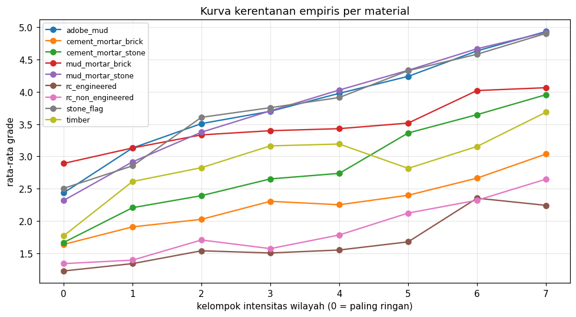

# Structural Damage Classification — Gempa Gorkha, Nepal 2015

Prediksi tingkat kerusakan bangunan (`damage_grade`, Grade 1–5) dari karakteristik struktural dan lokasi,
menggunakan data survei pasca-gempa Gorkha (Mw 7,8; 25 April 2015).
Tugas 1 *Supervised Machine Learning* — kompetisi Kaggle
[Structural Damage Classification](https://www.kaggle.com/competitions/structural-damage-classification).

| | |
|---|---|
| **Tipe masalah** | Klasifikasi multikelas (5 kelas, tidak seimbang) |
| **Metrik** | Macro F1-Score |
| **Model** | `Pipeline` scikit-learn: feature engineering custom + `ColumnTransformer`, blend LightGBM + XGBoost |
| **Validasi** | Stratified 5-fold CV, seluruh pipeline di-fit ulang tiap fold |
| **CV macro F1** | lihat [Hasil](#hasil) |

---

## Struktur repository

```
structural-damage-classification/
├── README.md
├── .gitignore
├── requirements.txt
├── data/                       # dataset Kaggle (tidak di-commit)
│   ├── train.csv
│   ├── test.csv
│   └── sample_submission.csv
├── notebooks/
│   ├── 01_eda.ipynb            # EDA terarah: 8 pertanyaan -> keputusan modeling
│   ├── 02_modeling.ipynb       # ablation fitur, tuning, CV, model final
│   └── 03_submission.ipynb     # prediksi test & file submission
├── scripts/
│   ├── __init__.py
│   ├── preprocess.py           # path, load data, konfigurasi fitur, ColumnTransformer
│   ├── feature_engineering.py  # transformer custom (sklearn API)
│   ├── train.py                # pipeline, ablation, tuning, CV, bobot kelas, training final
│   └── predict.py              # load model & tulis submission
├── models/
│   └── pipeline_model.pkl
├── submissions/
│   └── submission.csv
└── reports/
    ├── eda_findings.json
    ├── ablation_results.csv
    ├── cv_summary.json
    └── figures/
        ├── feature_importance.png
        ├── confusion_matrix.png
        ├── eda_fragility_curves.png
        ├── eda_id_neighbor_decay.png
        └── ... (gambar EDA lain)
```

---

## Cara mengunduh data

**Opsi A — Website Kaggle:** buka halaman kompetisi → *Join Competition* → *I Understand and Accept* →
tab **Data** → **Download All**. Ekstrak `train.csv`, `test.csv`, `sample_submission.csv` ke folder `data/`.

**Opsi B — Kaggle API:**

```bash
pip install kaggle
# simpan API token di ~/.kaggle/kaggle.json (Kaggle → Settings → API → Create New Token)
kaggle competitions download -c structural-damage-classification -p data
unzip data/structural-damage-classification.zip -d data
```

> Aturan kompetisi harus sudah di-*accept* di website, kalau tidak download/submit via API akan gagal.

---

## Cara menjalankan

### Lokal

```bash
git clone https://github.com/yafifaldin/structural-damage-classification.git
cd structural-damage-classification
pip install -r requirements.txt
# letakkan file CSV di data/
```

Lewat notebook (berurutan): `01_eda.ipynb` → `02_modeling.ipynb` → `03_submission.ipynb`.

Lewat command line:

```bash
python -m scripts.train --smoke             # cek cepat semua jalur kode (±5 menit)
python -m scripts.train --ablation          # ablation fitur + CV LightGBM & XGBoost + blend + model final
python -m scripts.train --models lgbm       # hanya LightGBM
python -m scripts.train --ablation --tune   # + RandomizedSearchCV LightGBM
python -m scripts.predict                   # -> submissions/submission.csv (label angka 1-5)
```

### Kaggle Notebook

1. Buat notebook baru dari halaman kompetisi (data otomatis ada di `/kaggle/input/...`).
2. `01_eda.ipynb` bersifat mandiri: cukup *File → Import Notebook* lalu *Run All*.
3. Untuk modeling, nyalakan **Settings → Internet** (perlu verifikasi nomor HP), lalu import
   `02_modeling.ipynb` (cell *Setup* otomatis meng-clone repo ini), atau jalankan:
   ```python
   !git clone --depth 1 https://github.com/yafifaldin/structural-damage-classification.git /kaggle/working/repo
   %cd /kaggle/working/repo
   !python -m scripts.train --smoke
   !python -m scripts.train --ablation
   !python -m scripts.predict
   ```
4. Output (model, gambar, submission) ditulis ke `/kaggle/working`; `submission.csv` juga disalin ke
   `/kaggle/working/submission.csv` agar bisa langsung di-submit.

Estimasi waktu di CPU Kaggle (iterasi 4): smoke test ±5 menit, ablation ±40 menit, CV LightGBM ±60 menit,
CV XGBoost ±60 menit, model final ±25 menit. Jalankan lewat **Save Version → Save & Run All**.
Di Kaggle semua output ditulis ke `/kaggle/working/` (di luar folder repo hasil clone).

---

## Workflow analisis

1. **EDA terarah** (`01_eda.ipynb`) — setiap analisis menjawab satu pertanyaan yang menentukan keputusan
   modeling (lihat [Temuan EDA](#temuan-eda)).
2. **Feature engineering** (`scripts/feature_engineering.py`), semuanya transformer scikit-learn:

   | Transformer | Isi | Supervised? |
   |---|---|---|
   | `StructuralFeatures` | prefiks `building_id` (kode distrik/VDC/ward/blok lama), nomor rumah tangga, periode alami `0,075·H^0,75`, kelangsingan, luas total, kelompok umur, peringkat kerentanan material (ala EMS-98) | tidak |
   | `GroupRelativeFeatures` | ukuran area, selisih umur/tinggi/lantai/luas/kerentanan terhadap rata-rata area, pangsa material di area | tidak |
   | `HierarchicalTargetEncoder` | probabilitas tiap grade per wilayah dengan *smoothing* ke wilayah induk, plus kombinasi wilayah × material/fondasi/atap/lantai/umur | ya, out-of-fold |
   | `IdNeighborEncoder` | grade rumah tangga dengan nomor survei terdekat di ward yang sama (k = 1, 2, 5, 10, 30), tanpa bangunan serumah | ya, out-of-fold |
   | `HouseholdEncoder` | jumlah, rata-rata, min, maks grade bangunan lain serumah | ya, out-of-fold |
   | `AdjacentAreaEncoder` | distribusi kerusakan ward/blok dengan kode sebelah | ya (area lain saja) |
   | `BuildingTypeClusterer` | tipe bangunan dari `MiniBatchKMeans` (one-hot + scaling dalam `Pipeline`) | tidak (eksperimen) |
   | `VulnerabilityTyper` | skor kerentanan dari model kecil berbasis fitur konstruksi saja, dibagi menjadi tipe | ya, out-of-fold (eksperimen) |
   | `ResidualIntensityEncoder` | **dua tahap**: (1) model tanpa lokasi memprediksi grade dari konstruksi; (2) sisa grade − prediksi dirata-ratakan per wilayah (id4→id10) dan per rumah tangga tetangga = intensitas guncangan bersih dari pengaruh komposisi bangunan | ya, out-of-fold |
   | `CategoricalCoder` | kategori konstruksi → `pandas.Categorical` (split native LightGBM) | tidak |

3. **Pipeline** (`scripts/train.py → build_pipeline`):
   `StructuralFeatures → [BuildingTypeClusterer] → [VulnerabilityTyper] → ColumnTransformer(num | cat | grp | te | nb | hh | adj | ri) → LGBMClassifier / XGBGradeClassifier`.
   Langkah dalam kurung siku diaktifkan oleh konfigurasi fitur. Model final adalah `BlendClassifier`:
   rata-rata tertimbang pipeline LightGBM dan XGBoost (bobot blend dipilih dari prediksi OOF) + bobot kelas.
4. **Pencegahan kebocoran:** encoder berlabel memakai *cross-fitting* di `fit_transform`
   (setiap baris train di-encode dari fold lain). Data baru di-encode dengan rata-rata tabel per fold,
   sehingga distribusinya sama dengan nilai out-of-fold saat training. Karena seluruh pipeline di-fit ulang
   di setiap fold CV, setiap kandidat tuning, dan setiap konfigurasi ablation, data validasi tidak pernah
   ikut membentuk fiturnya sendiri.
5. **Ablation fitur** (`run_ablation`): mulai dari fitur iterasi 2, setiap perubahan diuji berurutan pada
   subsampel 30% wilayah utuh (3-fold, perbandingan berpasangan pada baris & fold yang sama). Perubahan
   berbasis bukti EDA dipertahankan bila skor naik; eksperimen clustering harus naik ≥ 0,002.
6. **Tuning:** `RandomizedSearchCV` pada pipeline (scoring `f1_macro`), pada subsampel wilayah utuh dengan
   cache transformer; parameter default dipertahankan bila lebih baik.
7. **Evaluasi & optimasi macro F1:** Stratified 5-fold OOF → probabilitas dikalikan bobot per kelas
   (coordinate search), diuji jujur dengan bobot dari 4 fold yang dievaluasi di fold ke-5. Bobot disimpan di
   dalam model (`WeightedArgmaxClassifier`). Prediksi OOF disimpan untuk analisis error.
8. **Submission** (`03_submission.ipynb` / `scripts/predict.py`): urutan baris sama dengan
   `sample_submission.csv`, label ditulis sebagai **angka 1–5** (penilai Kaggle menolak label `"Grade X"`).

---

## Temuan EDA

| # | Pertanyaan | Temuan | Keputusan |
|---|---|---|---|
| A | Nilai anomali? | Umur 0 (n=3.349) rata-rata grade 2,19; lantai ≥6 grade 1,96; umur ≥200 hampir normal | tidak perlu pembersihan, model pohon menangkapnya |
| B | Noise label? | Bangunan identik di blok yang sama hanya 80% ber-grade sama | ada batas atas skor; peningkatan harus datang dari lokasi yang lebih halus |
| C | Test = populasi yang sama? | Adversarial AUC **0,499**; fraksi test per wilayah 30% ± 1,4% | CV acak representatif untuk leaderboard |
| D | Level lokasi terbaik? | `id9` (macro F1 0,524 hanya dari modus grup) > `id6` > `ward_id`; `id10` grup median 7 | pakai hierarki penuh dengan smoothing kuat di level halus |
| E | Struktur nomor ID? | Nomor naik per 10; digit terakhir = bangunan dalam rumah tangga. Serumah *kurang* mirip (0,40) dari acak (0,45); rumah tangga sebelah paling mirip (0,53), memudar setelah ±30 tetangga. Ward berurutan mirip | tetangga dihitung per rumah tangga, fitur serumah terpisah, fitur ward sebelah |
| F | Konstruksi setelah lokasi dikontrol? | material 0,30, fondasi 0,29, atap 0,27, lantai dasar 0,26, lantai atas 0,24, umur 0,24; posisi/denah/lereng ≈ 0 | kombinasi wilayah × konstruksi utama |
| G | Proksi fisika? | 0,10–0,11 setelah lokasi dikontrol | dipertahankan, kontribusi kecil |
| H | Kelas vs intensitas? | Grade 2–3 tersebar di wilayah ringan–sedang; std grade dalam blok 0,86 | optimasi bobot kelas untuk macro F1 |



---

## Hasil

| Iterasi | Eksperimen | CV macro F1 (held-out) |
|---|---|---|
| 1 | LightGBM, fitur mentah + ID lokasi kategorikal | 0,533 (argmax) |
| 1 | + prefiks `building_id`, target encoding berjenjang, tetangga ID, fitur area, bobot kelas | 0,596 |
| 2 | Refactor ke `Pipeline` + `ColumnTransformer` | _isi dari `cv_summary.json`_ |
| 3 | Ablation fitur dari EDA + clustering (LightGBM) | _isi dari `ablation_results.csv`_ |
| 3 | + blend XGBoost (dijalankan manual di notebook) | _isi_ |
| 4 | + intensitas residual dua tahap, LightGBM lr 0,05, blend resmi | _isi dari `cv_summary.json`_ |

| Submission | Public LB |
|---|---|
| Iterasi 1 (skrip awal) | 0,60365 |
| Iterasi 3 (pipeline + ablation, LightGBM) | 0,60228 |
| Iterasi 3 + blend XGBoost | 0,60324 |
| Iterasi 4 | _isi_ |
| Private | _diumumkan setelah kompetisi selesai_ |

Selisih antar submission di atas (±0,001) lebih kecil dari variasi acak public LB (±0,002–0,003),
dan CV (≈0,596) konsisten dengan LB (≈0,603) — validasi dapat dipercaya.

---

## Interpretasi

**1. Lokasi adalah faktor dominan karena menggantikan data guncangan yang tidak ada.**
Dataset tidak memuat percepatan tanah, jarak ke episentrum, atau jenis tanah detail. Intensitas guncangan
bervariasi besar antar wilayah, sehingga model belajar "seberapa keras guncangan di sini" dari kerusakan
bangunan lain di wilayah yang sama. Kode wilayah lama di `building_id` lebih informatif daripada `ward_id`
baru karena unitnya lebih kecil, dan tetangga nomor survei menambah informasi pada skala rumah tangga.

**2. Kerusakan = intensitas guncangan × kerentanan bangunan.**
Di wilayah yang sama, bangunan beton bertulang dan semen-bata rusak jauh lebih ringan daripada batu-lumpur.
Selisih material terkuat-terlemah membesar dari 1,7 grade di wilayah ringan menjadi 2,7 grade di wilayah berat
(kurva kerentanan di atas). Karena itu kombinasi wilayah × konstruksi termasuk fitur terpenting.

**3. Bangunan serumah bukan "kembar".**
Bangunan kedua dan seterusnya dalam satu rumah tangga rata-rata 0,22 grade lebih ringan dari tetangganya
(kemungkinan bangunan tambahan yang lebih kecil), sehingga mereka diperlakukan sebagai fitur terpisah,
bukan sebagai tetangga terdekat.

**4. Proksi dinamika struktur membantu, tetapi kontribusinya kecil.**
Periode alami dan kelangsingan berpengaruh setara jumlah lantai: data hanya berisi tinggi, lantai, dan luas,
tanpa detail elemen struktur.

**5. Grade tengah paling sulit dan ada noise label.**
Grade 2 dan 3 memiliki F1 terendah; bangunan dengan fitur identik di blok yang sama pun hanya 80% ber-grade sama.
Optimasi bobot kelas mengorbankan sedikit Grade 5 untuk menaikkan recall Grade 2–4, dan itu menaikkan macro F1.

**6. Clustering:** lihat `reports/ablation_results.csv`. Clustering hanya dipertahankan jika menaikkan CV;
jika tidak, artinya model pohon sudah menangkap pola tipe bangunan dari fitur aslinya.

**Keterbatasan:** tidak ada koordinat geografis maupun data seismik; label adalah penilaian visual surveyor.
Model Neural Network (termasuk GNN) tidak dipakai sesuai aturan tugas.

---

## Aturan yang diikuti

- Dataset tidak di-commit (`data/*.csv` di `.gitignore`).
- Preprocessing, training, tuning, dan ablation memakai `Pipeline` + `ColumnTransformer`.
- Setiap function/class di `scripts/*.py` memiliki docstring.
- Tidak menggunakan model Neural Network.
