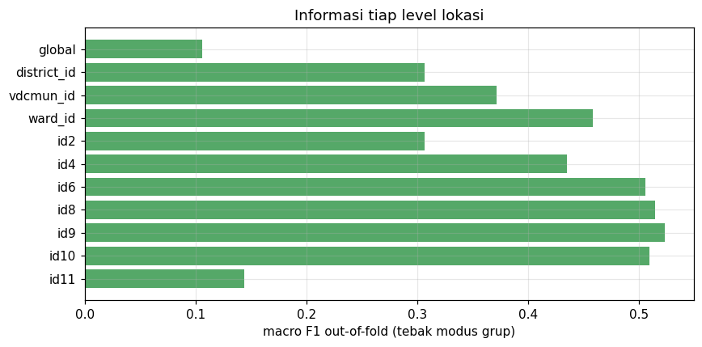
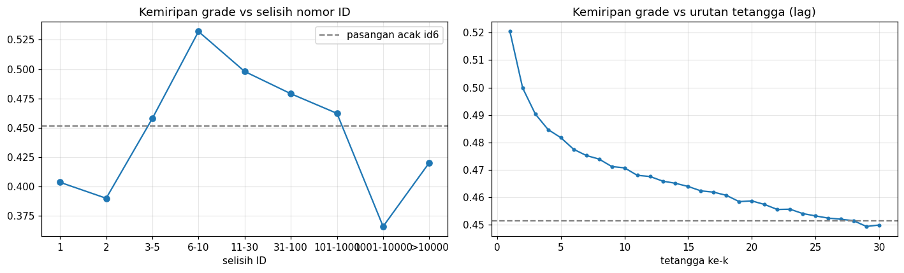
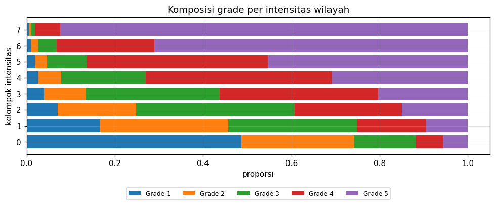
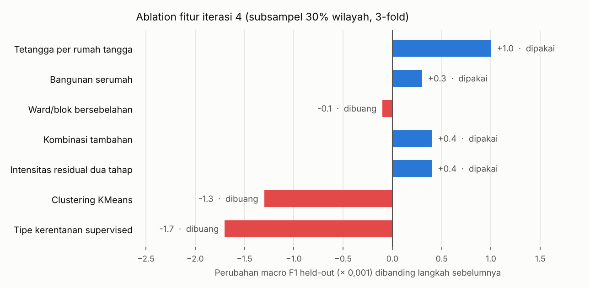
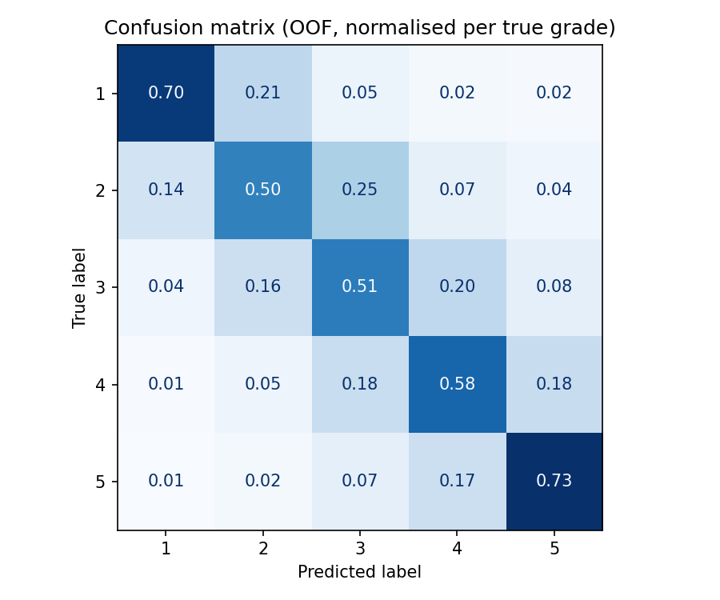
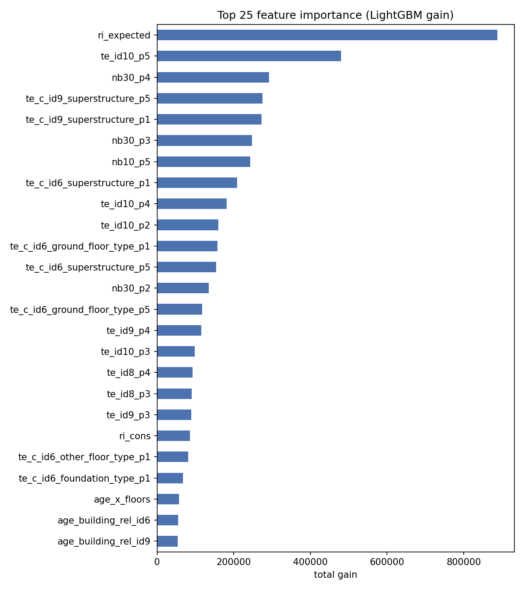

# Klasifikasi Tingkat Kerusakan Bangunan Pasca Gempa Gorkha 2015


[Structural Damage Classification](https://www.kaggle.com/competitions/structural-damage-classification).

Nama : Yafi Muhammad Faldin
NRP : 5052241026

---

## Daftar Isi

1. [Pendahuluan](#1-pendahuluan)
2. [Dataset](#2-dataset)
3. [Struktur Repository dan Cara Penggunaan](#3-struktur-repository-dan-cara-penggunaan)
4. [Exploratory Data Analysis](#4-exploratory-data-analysis)
5. [Metodologi](#5-metodologi)
6. [Hasil Eksperimen](#6-hasil-eksperimen)
7. [Pembahasan](#7-pembahasan)
8. [Kesimpulan](#8-kesimpulan)
9. [Keterbatasan dan Saran](#9-keterbatasan-dan-saran)
10. [Referensi](#10-referensi)

---

## 1. Pendahuluan

Pada 25 April 2015, gempa berkekuatan Mw 7,8 dengan hiposentrum dangkal (sekitar 8–15 km) terjadi di
wilayah Gorkha, Nepal. Ratusan ribu bangunan rusak atau runtuh. Setelah gempa, Central Bureau of
Statistics (CBS) Nepal melakukan survei besar-besaran yang mencatat karakteristik bangunan sebelum gempa
(material, fondasi, atap, umur, tinggi, dan sebagainya) beserta tingkat kerusakan yang dinilai surveyor.

Tujuan tugas ini adalah membangun model yang memprediksi tingkat kerusakan (`damage_grade`, Grade 1–5)
dari data survei tersebut. Metrik evaluasinya **Macro F1-Score**, yaitu rata-rata F1 dari kelima kelas
dengan bobot yang sama. Artinya kelas yang jumlahnya sedikit (Grade 1 dan 2) sama pentingnya dengan
Grade 5 yang paling banyak, sehingga model tidak cukup hanya "jago" menebak kelas mayoritas.

Aturan tugas yang perlu dipatuhi: preprocessing, training, dan tuning harus memakai `Pipeline` dan
`ColumnTransformer`, setiap function/class di file `.py` harus punya docstring, dan **tidak boleh memakai
model Neural Network**.

---

## 2. Dataset

| File | Jumlah baris | Keterangan |
|---|---|---|
| `train.csv` | 533.465 | fitur + `damage_grade` |
| `test.csv` | 228.629 | fitur tanpa label |
| `sample_submission.csv` | 228.629 | format submission |

Setiap baris adalah satu bangunan. Kolomnya terbagi menjadi tiga kelompok:

| Kelompok | Kolom |
|---|---|
| Identitas & lokasi | `building_id`, `district_id`, `vdcmun_id`, `ward_id` |
| Numerik | `count_floors_pre_eq`, `age_building`, `plinth_area_sq_ft`, `height_ft_pre_eq` |
| Kategorikal | `land_surface_condition`, `foundation_type`, `roof_type`, `ground_floor_type`, `other_floor_type`, `position`, `plan_configuration`, `superstructure` |

Distribusi kelas pada data train tidak seimbang:

| Grade 1 | Grade 2 | Grade 3 | Grade 4 | Grade 5 |
|---|---|---|---|---|
| 10,3% | 11,5% | 17,9% | 24,1% | 36,2% |

Hal penting yang perlu dicatat sejak awal: dataset ini **tidak memuat data guncangan tanah sama sekali**
(tidak ada percepatan tanah, jarak ke episentrum, atau jenis tanah yang detail). Padahal secara teknik
sipil, kerusakan bangunan ditentukan oleh dua hal: seberapa kuat guncangan yang diterima dan seberapa
rentan bangunannya. Informasi pertama hanya bisa didekati lewat lokasi.

---

## 3. Struktur Repository dan Cara Penggunaan

### 3.1 Struktur folder

```
structural-damage-classification/
├── README.md
├── .gitignore
├── requirements.txt
├── data/                       # dataset Kaggle (tidak di-commit)
├── notebooks/
│   ├── 01_eda.ipynb            # EDA terarah: 8 pertanyaan -> keputusan modeling
│   ├── 02_modeling.ipynb       # smoke test, ablation, CV, blend, model final, submission
│   └── 03_submission.ipynb     # prediksi test dari model tersimpan
├── scripts/
│   ├── __init__.py
│   ├── preprocess.py           # path, load data, konfigurasi fitur, ColumnTransformer
│   ├── feature_engineering.py  # transformer custom (API scikit-learn)
│   ├── train.py                # pipeline, ablation, tuning, CV, blend, training final
│   └── predict.py              # load model & tulis submission
├── models/
│   └── pipeline_model.pkl
├── submissions/
│   └── submission.csv
└── reports/
    ├── eda_findings.json
    ├── ablation_results.csv
    ├── cv_summary.json
    └── figures/
```

### 3.2 Mengunduh data

Lewat website: buka halaman kompetisi, klik *Join Competition* lalu *I Understand and Accept*, buka tab
**Data**, dan klik **Download All**. Ekstrak `train.csv`, `test.csv`, dan `sample_submission.csv` ke folder
`data/`.

Lewat Kaggle API (token disimpan di `~/.kaggle/kaggle.json`):

```bash
pip install kaggle
kaggle competitions download -c structural-damage-classification -p data
unzip data/structural-damage-classification.zip -d data
```

### 3.3 Menjalankan di komputer lokal

```bash
git clone https://github.com/yafifaldin/structural-damage-classification.git
cd structural-damage-classification
pip install -r requirements.txt
# letakkan file CSV di data/

python -m scripts.train --smoke       # cek cepat semua jalur kode (±5 menit)
python -m scripts.train --ablation    # ablation fitur + CV LightGBM & XGBoost + blend + model final
python -m scripts.predict             # -> submissions/submission.csv
```

Notebook bisa dijalankan berurutan: `01_eda.ipynb` → `02_modeling.ipynb` → `03_submission.ipynb`.

### 3.4 Menjalankan di Kaggle

1. Buat notebook baru dari halaman kompetisi (data otomatis terpasang).
2. `01_eda.ipynb` bisa langsung di-import (*File → Import Notebook*) dan dijalankan karena tidak butuh
   folder `scripts/`.
3. Untuk `02_modeling.ipynb`, nyalakan **Settings → Internet** (butuh verifikasi nomor HP). Cell pertama
   otomatis meng-clone repo ini dari GitHub.
4. Karena prosesnya lama (±2 jam di CPU Kaggle), jalankan lewat **Save Version → Save & Run All** supaya tetap berjalan
   walaupun browser ditutup.
5. Hasil ada di tab **Output** (`/kaggle/working/`). File `submission.csv` bisa langsung di-submit.

Catatan: penilai Kaggle hanya menerima label berupa **angka 1–5**. Submission dengan label `"Grade 3"`
(seperti di `sample_submission.csv`) akan ditolak dengan error *"The input string 'Grade' was not in a
correct format"*. Script `predict.py` sudah otomatis menulis angka.

---

## 4. Exploratory Data Analysis

EDA tidak saya buat sebagai kumpulan grafik umum. Saya menyusunnya sebagai delapan pertanyaan, dan
jawaban tiap pertanyaan menentukan satu keputusan di tahap modeling. Semua angka di bagian ini berasal
dari `notebooks/01_eda.ipynb` dan tersimpan di `reports/eda_findings.json`.

### 4.1 Kualitas data

Data tidak memiliki nilai kosong maupun `building_id` duplikat, dan tidak ada ID test yang muncul di
train. Ada beberapa nilai yang terlihat aneh:

| Kelompok | Jumlah | Rata-rata grade | Selisih terhadap tetangga se-ward |
|---|---|---|---|
| umur = 0 tahun | 3.349 | 2,19 | −0,99 |
| umur ≥ 200 tahun (termasuk 999) | 2.376 | 3,61 | +0,12 |
| jumlah lantai ≥ 6 | 307 | 1,96 | −0,85 |
| luas > persentil 99,9 | 534 | 2,50 | −0,26 |

Umur 999 kemungkinan besar adalah kode "tidak diketahui", tetapi rata-rata grade kelompok ini hampir
sama dengan rata-rata keseluruhan (3,64), jadi tidak terlalu berbahaya. Bangunan baru (umur 0) dan
bangunan tinggi justru jauh lebih ringan kerusakannya, yang masuk akal karena biasanya dibangun dengan
beton bertulang. Karena model berbasis pohon bisa membuat split langsung di nilai-nilai tersebut, saya
memutuskan **tidak melakukan pembersihan atau imputasi**.

### 4.2 Apakah data test berasal dari populasi yang sama?

Saya melakukan *adversarial validation*: sebuah model dilatih untuk membedakan baris train dan test.
Hasilnya AUC **0,499**, artinya model sama sekali tidak bisa membedakan keduanya. Fraksi data test di
setiap wilayah juga seragam (30% ± 1,4%), dan tidak berkorelasi dengan tingkat kerusakan wilayah
(korelasi 0,02).

Kesimpulannya, test diambil secara acak dari populasi yang sama. Ini penting karena berarti
**cross-validation acak bisa dipercaya** untuk memperkirakan skor leaderboard.

### 4.3 Lokasi sebagai pengganti data guncangan

Untuk mengukur seberapa informatif setiap level lokasi, saya memakai baseline sederhana: tebak grade
yang paling sering muncul di grup tersebut (dihitung *out-of-fold* supaya jujur).

Temuan yang cukup mengejutkan adalah bahwa `building_id` ternyata tidak acak. Prefiksnya adalah kode
administrasi wilayah lama sebelum restrukturisasi 2017: 2 digit pertama distrik, 4 digit VDC, 6 digit
ward, dan seterusnya sampai blok yang lebih kecil.



| Level | Jumlah grup | Ukuran median | Macro F1 (modus grup) |
|---|---|---|---|
| tanpa lokasi | 1 | 533.465 | 0,106 |
| `district_id` | 11 | 53.704 | 0,306 |
| `ward_id` | 945 | 541 | 0,458 |
| `id6` (ward lama) | 5.666 | 73 | 0,506 |
| `id9` (blok) | 10.257 | 60 | **0,524** |
| `id10` | 74.823 | 7 | 0,510 |
| `id11` | 510.026 | 1 | 0,144 |

Hanya dengan menebak grade terbanyak di blok `id9`, macro F1 sudah 0,524, tanpa melihat satu pun fitur
bangunan. Level yang lebih halus (`id10`) mulai turun karena grupnya terlalu kecil (median 7 bangunan)
sehingga tebakannya tidak stabil. Dari sini saya memutuskan memakai **seluruh hierarki lokasi** dengan
*smoothing* bertingkat: level yang grupnya kecil "ditarik" ke nilai level induknya.

### 4.4 Struktur nomor ID dan tetangga

Saya juga memeriksa apakah bangunan dengan nomor ID berdekatan memiliki grade yang mirip.



Grafik kiri menunjukkan pola yang awalnya membingungkan. Pasangan dengan selisih ID 1–2 justru *kurang*
mirip (0,40) dibanding pasangan acak dalam ward yang sama (0,45), sedangkan selisih 6–10 paling mirip
(0,53). Setelah diperiksa, nomor ID ternyata naik per 10. Digit terakhir adalah nomor bangunan di dalam
satu rumah tangga, dan 11 digit pertama adalah nomor rumah tangga. Jadi selisih 1–2 berarti bangunan
**serumah**, yang biasanya terdiri dari rumah utama dan bangunan tambahan yang lebih kecil. Bangunan
tambahan (digit terakhir > 1) rata-rata 0,22 grade lebih ringan dari tetangganya.

Grafik kanan menunjukkan kemiripan menurun seiring jarak dan hampir sama dengan acak setelah sekitar 30
tetangga. Saya juga menemukan bahwa kode ward yang berurutan memiliki tingkat kerusakan yang lebih mirip
(selisih rata-rata 0,335 dibanding 0,385 bila diacak), sehingga kode ward kemungkinan disusun berurutan
secara geografis.

Keputusan yang diambil: fitur tetangga dihitung per rumah tangga (bukan per bangunan), bangunan serumah
dikeluarkan dari daftar tetangga dan dijadikan fitur tersendiri, lalu ditambahkan fitur dari ward/blok
yang kodenya bersebelahan.

### 4.5 Pengaruh konstruksi setelah lokasi dikontrol

Lokasi dan konstruksi saling berkaitan. Contohnya, wilayah pegunungan cenderung didominasi rumah
batu-lumpur. Untuk melihat pengaruh konstruksi yang "murni", saya menghitung selisih grade setiap
bangunan terhadap rata-rata tetangganya di ward yang sama, lalu mengukur sebaran selisih tersebut per
kategori.

| Fitur | Sebaran sebelum lokasi dikontrol | Sebaran setelah lokasi dikontrol |
|---|---|---|
| `superstructure` | 0,723 | **0,304** |
| `foundation_type` | 0,627 | 0,293 |
| `roof_type` | 0,481 | 0,269 |
| `ground_floor_type` | 0,552 | 0,260 |
| `other_floor_type` | 0,500 | 0,244 |
| umur | 0,375 | 0,243 |
| luas | 0,239 | 0,122 |
| jumlah lantai | 0,359 | 0,109 |
| `plan_configuration` | 0,132 | 0,048 |
| `position` | 0,106 | 0,036 |
| `land_surface_condition` | 0,036 | 0,010 |

Material, fondasi, atap, dan jenis lantai tetap berpengaruh kuat walaupun lokasi sudah dikontrol.
Sebaliknya, posisi bangunan, bentuk denah, dan kemiringan lahan hampir tidak berpengaruh.


Grafik di atas mirip dengan *fragility curve* di bidang teknik gempa. Wilayah dibagi menjadi delapan
kelompok berdasarkan tingkat kerusakan rata-rata (sebagai proksi intensitas guncangan), lalu dihitung
rata-rata grade per material. Di wilayah yang paling ringan, bangunan beton bertulang (RC engineered)
rata-rata hanya grade 1,2, sedangkan bangunan bata-lumpur sudah grade 2,9. Di wilayah paling berat,
bangunan batu-lumpur, adobe, dan batu pipih hampir semuanya grade 5 (rata-rata 4,9), sementara RC
engineered masih sekitar 2,2. Selisih antara material terkuat dan terlemah membesar dari 1,7 grade
menjadi 2,7 grade. Artinya pengaruh material bergantung pada intensitas guncangan, sehingga model perlu
fitur **interaksi lokasi × konstruksi**, bukan hanya keduanya secara terpisah.

### 4.6 Proksi dinamika struktur

Saya menambahkan beberapa fitur dari konsep dinamika struktur, yaitu perkiraan periode getar alami
(T ≈ 0,075·H^0,75, H dalam meter) dan kelangsingan (tinggi/√luas). Setelah lokasi dikontrol,
sebarannya hanya 0,10–0,11, setara dengan jumlah lantai. Fitur ini tetap dipakai, tetapi bukan sumber
peningkatan yang besar. Hal ini wajar karena data hanya berisi tinggi, jumlah lantai, dan luas, tanpa
detail elemen struktur seperti kolom atau tulangan.

### 4.7 Distribusi kelas terhadap intensitas wilayah



Di wilayah paling ringan (kelompok 0), hampir setengah bangunan adalah Grade 1. Di wilayah paling berat
(kelompok 7), 92% adalah Grade 5. Masalahnya ada di tengah: Grade 2 dan Grade 3 tersebar di kelompok 0
sampai 4 dan tidak pernah dominan di satu kelompok pun. Jadi lokasi saja tidak cukup untuk memisahkan
kedua kelas ini, dan kemungkinan besar keduanya akan menjadi kelas dengan F1 terendah.

### 4.8 Noise pada label

Saya mencari bangunan yang **seluruh fiturnya identik** dan berada di blok `id9` yang sama, lalu
memeriksa seberapa sering grade-nya sama. Hasilnya hanya 80%, dan angka ini pun masih optimis karena
dihitung pada data yang sama. Jika lokasinya hanya sampai `ward_id`, kecocokannya turun menjadi 77%, dan
tanpa lokasi hanya 64%. Ini menunjukkan ada variasi yang tidak bisa dijelaskan oleh fitur yang tersedia,
misalnya kualitas pengerjaan bangunan atau subjektivitas surveyor saat menilai batas antar-grade.

### 4.9 Ringkasan EDA

| # | Pertanyaan | Temuan utama | Keputusan |
|---|---|---|---|
| A | Ada anomali? | umur 0 dan lantai ≥ 6 jauh lebih ringan | tidak perlu dibersihkan |
| B | Seberapa besar noise label? | bangunan identik di blok yang sama hanya 80% ber-grade sama | ada batas atas skor |
| C | Test = populasi yang sama? | adversarial AUC 0,499 | CV acak dapat dipercaya |
| D | Level lokasi terbaik? | `id9` dari `building_id` | target encoding berjenjang |
| E | Struktur ID? | digit terakhir = bangunan dalam rumah tangga | tetangga per rumah tangga, fitur serumah |
| F | Konstruksi setelah lokasi dikontrol? | material, fondasi, atap, lantai, umur | interaksi lokasi × konstruksi |
| G | Proksi fisika berguna? | ya, tetapi kecil | dipertahankan |
| H | Kelas vs intensitas? | Grade 2–3 tersebar | optimasi bobot kelas |

---

## 5. Metodologi

### 5.1 Alur kerja

```
data mentah
   │
   ▼
StructuralFeatures ─── kode wilayah dari building_id, nomor rumah tangga, proksi fisika
   │
   ▼
ColumnTransformer
   ├── num : passthrough (fitur numerik & lokasi)
   ├── cat : CategoricalCoder (kategori → pandas category)
   ├── grp : GroupRelativeFeatures (bangunan dibandingkan dengan areanya)
   ├── te  : HierarchicalTargetEncoder (lokasi & lokasi × konstruksi)
   ├── nb  : IdNeighborEncoder (tetangga rumah tangga terdekat)
   ├── hh  : HouseholdEncoder (bangunan lain serumah)
   ├── adj : AdjacentAreaEncoder (ward/blok bersebelahan)
   └── ri  : ResidualIntensityEncoder (intensitas guncangan bersih, dua tahap)
   │
   ▼
LGBMClassifier  dan  XGBGradeClassifier   (pipeline fitur yang sama)
   │
   ▼
BlendClassifier: α·LightGBM + (1−α)·XGBoost  →  bobot per kelas  →  prediksi
```

Semua langkah di atas berupa transformer scikit-learn (memiliki `fit`, `transform`, dan
`get_feature_names_out`), sehingga seluruh proses dari data mentah sampai prediksi berada dalam satu
objek `Pipeline` dan disimpan sebagai satu file `.pkl`.

### 5.2 Feature engineering

| Transformer | Isi | Pakai label? |
|---|---|---|
| `StructuralFeatures` | prefiks `building_id` (distrik → blok), nomor rumah tangga, periode alami, kelangsingan, kelompok umur, peringkat kerentanan material ala EMS-98 | tidak |
| `GroupRelativeFeatures` | ukuran area, selisih umur/tinggi/lantai/luas/kerentanan dari rata-rata area, pangsa material di area | tidak |
| `HierarchicalTargetEncoder` | probabilitas tiap grade per wilayah, di-*smoothing* ke wilayah induk, ditambah kombinasi wilayah × material/fondasi/atap/lantai/umur | ya |
| `IdNeighborEncoder` | grade rumah tangga terdekat dalam ward yang sama (k = 1, 2, 5, 10, 30), tanpa bangunan serumah | ya |
| `HouseholdEncoder` | jumlah, rata-rata, minimum, dan maksimum grade bangunan lain serumah | ya |
| `AdjacentAreaEncoder` | distribusi kerusakan ward/blok dengan kode bersebelahan | ya (hanya area lain) |
| `ResidualIntensityEncoder` | tahap 1: model tanpa lokasi menebak grade dari konstruksi; tahap 2: sisa (grade − tebakan) dirata-ratakan per wilayah dan per tetangga | ya |
| `BuildingTypeClusterer` | tipe bangunan dari `MiniBatchKMeans` (eksperimen) | tidak |
| `VulnerabilityTyper` | tipe bangunan dari skor kerentanan supervised (eksperimen) | ya |

Ide di balik `ResidualIntensityEncoder` perlu sedikit penjelasan. Target encoding wilayah biasa
mencampur dua hal sekaligus: kuatnya guncangan dan banyaknya bangunan rentan di wilayah itu. Wilayah
yang isinya rumah batu-lumpur akan terlihat "parah" walaupun guncangannya sedang. Dengan mengurangkan
grade yang "seharusnya" untuk tipe bangunan tersebut, sisa yang dirata-ratakan per wilayah lebih
mendekati intensitas guncangan yang sebenarnya.

### 5.3 Mencegah kebocoran data

Fitur yang memakai label (target encoding dan tetangga) sangat rawan bocor. Kalau label bangunan itu
sendiri ikut dipakai untuk menghitung fiturnya, model akan terlihat bagus saat validasi tetapi gagal di
test. Untuk mencegahnya, semua encoder berlabel memakai *cross-fitting*, dengan prinsip yang sama seperti
`sklearn.preprocessing.TargetEncoder`:

1. Saat `fit_transform`, data train dibagi 5 fold. Baris di fold *k* di-encode hanya dari label 4 fold
   lainnya.
2. Saat `transform` untuk data baru (validasi atau test), hasilnya adalah rata-rata dari 5 tabel fold
   tersebut, sehingga distribusi nilainya sama dengan yang dilihat model saat training.
3. Seluruh pipeline di-fit ulang di setiap fold cross-validation, sehingga data validasi tidak pernah
   ikut membentuk fiturnya sendiri.

### 5.4 Model dan optimasi macro F1

Model utama adalah **LightGBM** (900 pohon, learning rate 0,05) dan **XGBoost** (600 pohon, kedalaman 7)
yang memakai pipeline fitur yang sama. Model berbasis pohon dipilih karena datanya tabular dengan
banyak fitur kategorikal, dan aturan tugas melarang Neural Network.

Model biasa memilih kelas dengan probabilitas tertinggi (*argmax*), yang cenderung menguntungkan kelas
mayoritas. Karena metriknya macro F1, saya mengalikan probabilitas setiap kelas dengan bobot tertentu
sebelum argmax. Bobot dicari dengan *coordinate search* pada prediksi out-of-fold. Supaya tidak
overfit, skor yang dilaporkan adalah skor *held-out*: bobot dicari di 4 fold lalu diuji di fold ke-5.

### 5.5 Validasi dan ablation

Validasi memakai Stratified 5-Fold CV. Untuk memilih fitur, saya melakukan **ablation bertahap**. Mulai
dari set fitur iterasi sebelumnya, setiap perubahan diuji satu per satu pada subsampel 30% wilayah
(3-fold), dan hanya dipertahankan kalau skornya naik. Untuk eksperimen clustering, syaratnya lebih
ketat, yaitu harus naik minimal 0,002. Subsampel diambil per wilayah utuh, bukan per baris acak, supaya
kepadatan tetangga tetap sama dengan data asli.

---

## 6. Hasil Eksperimen

Semua angka di bagian ini berasal dari run `notebooks/02_modeling.ipynb` iterasi 4 di CPU Kaggle.
Total waktu run sekitar 2 jam 10 menit (smoke test 1 menit, ablation 23 menit, CV LightGBM 32 menit,
CV XGBoost 51 menit, model final 21 menit). Ringkasan lengkapnya tersimpan di `reports/cv_summary.json`.

### 6.1 Riwayat iterasi

| Iterasi | Perubahan | CV macro F1 (held-out) | Public LB |
|---|---|---|---|
| 1 | LightGBM, fitur mentah + ID lokasi sebagai kategori | 0,533 | – |
| 1 | + prefiks `building_id`, target encoding berjenjang, tetangga ID, fitur area, bobot kelas | 0,5956 | 0,60365 |
| 3 | refactor ke `Pipeline` + `ColumnTransformer`, ablation fitur hasil EDA | – | 0,60228 |
| 3 | + blend dengan XGBoost (dicoba manual di notebook) | – | 0,60324 |
| 4 | fitur terpilih dari ablation + intensitas residual + LightGBM lr 0,05 + blend resmi | **0,6003** | *isi* |

Kenaikan terbesar terjadi di iterasi 1, ketika saya menemukan bahwa prefiks `building_id` adalah kode
wilayah yang lebih halus dan memakainya sebagai fitur lokasi (dari 0,533 ke 0,596). Setelah itu
kenaikannya kecil-kecil: iterasi 4 naik +0,0047 dibanding iterasi 1 pada CV. Kelima fold iterasi 4
cukup stabil, yaitu 0,6000; 0,5980; 0,6017; 0,6016; dan 0,6004.

### 6.2 Ablation fitur

Ablation dijalankan pada 160.286 bangunan (30% wilayah) dengan 3-fold CV. Setiap baris dibandingkan
dengan konfigurasi terbaik sebelumnya, bukan dengan baseline.



| Langkah | Macro F1 held-out | Perubahan | Dipakai? |
|---|---|---|---|
| baseline (fitur iterasi 2) | 0,5906 | – | ya |
| tetangga per rumah tangga | 0,5916 | +0,0010 | ya |
| bangunan serumah | 0,5918 | +0,0003 | ya |
| ward/blok bersebelahan | 0,5917 | −0,0001 | tidak |
| kombinasi tambahan (lantai atas, umur, id9 × material) | 0,5923 | +0,0004 | ya |
| intensitas residual dua tahap | 0,5926 | +0,0004 | ya |
| clustering KMeans | 0,5913 | −0,0013 | tidak |
| tipe kerentanan supervised | 0,5909 | −0,0017 | tidak |

Konfigurasi akhir menaikkan skor subsampel dari 0,5906 menjadi 0,5926 (+0,0020). Perubahan terbesar
datang dari perbaikan fitur tetangga, sesuai temuan EDA bahwa bangunan serumah justru kurang mirip
dibanding rumah tangga sebelahnya (bagian 4.4). Perlu dicatat bahwa beberapa kenaikan (+0,0003 sampai
+0,0004) sangat kecil, kemungkinan masih di dalam variasi acak subsampel. Jadi langkah tersebut lebih
tepat disebut "tidak merugikan" daripada "terbukti membantu".

### 6.3 Perbandingan model

| Model | Macro F1 held-out (CV 5-fold) |
|---|---|
| LightGBM | 0,5993 |
| XGBoost | 0,5991 |
| **Blend 0,6 × LightGBM + 0,4 × XGBoost** | **0,6003** |

LightGBM dan XGBoost hampir sama persis (selisih 0,0002). Blend menaikkan sekitar 0,001, kenaikan yang
kecil tetapi konsisten dengan hasil public LB iterasi 3 (0,60228 → 0,60324). Bobot blend 0,6/0,4 dipilih
dari prediksi out-of-fold.

### 6.4 Performa per kelas

| Grade | Precision | Recall | F1 | Jumlah data |
|---|---|---|---|---|
| 1 | 0,699 | 0,698 | **0,698** | 55.170 |
| 2 | 0,449 | 0,502 | **0,474** | 61.080 |
| 3 | 0,473 | 0,515 | **0,493** | 95.488 |
| 4 | 0,567 | 0,579 | **0,573** | 128.691 |
| 5 | 0,804 | 0,728 | **0,764** | 193.036 |
| macro avg | 0,598 | 0,604 | 0,600 | |

Akurasi keseluruhan 0,625. Bobot kelas hasil optimasi adalah [1,22; 1,65; 1,49; 1,28; 1,00] untuk
Grade 1–5. Bobot Grade 2 dan 3 paling besar, artinya model "didorong" untuk lebih sering menebak kedua
kelas tersebut. Akibatnya recall Grade 5 turun (0,728) tetapi presisinya tinggi (0,804), dan macro F1
secara keseluruhan naik.



Confusion matrix di atas dinormalisasi per baris (grade sebenarnya). Hampir semua kesalahan terjadi ke
grade yang bersebelahan. Grade 2 paling sering tertukar dengan Grade 3 (25%) dan Grade 1 (14%), Grade 3
tertukar dengan Grade 4 (20%) dan Grade 2 (16%), sedangkan Grade 4 terbagi rata ke Grade 3 dan Grade 5
(masing-masing 18%). Dari perhitungan saya, sekitar **75% kesalahan hanya meleset satu grade**, dan
bangunan yang meleset dua grade atau lebih hanya sekitar 9% dari total data. Jadi walaupun macro F1
"hanya" 0,60, model jarang salah besar (misalnya menebak Grade 1 untuk bangunan yang runtuh).

### 6.5 Fitur paling berpengaruh



Lima fitur teratas berdasarkan *gain* LightGBM:

| Peringkat | Fitur | Arti |
|---|---|---|
| 1 | `ri_expected` | perkiraan grade dari konstruksi + intensitas residual di blok `id10` |
| 2 | `te_id10_p5` | proporsi Grade 5 di blok `id10` |
| 3 | `nb30_p4` | proporsi Grade 4 di 30 rumah tangga terdekat |
| 4 | `te_c_id9_superstructure_p5` | proporsi Grade 5 untuk material yang sama di blok `id9` |
| 5 | `te_c_id9_superstructure_p1` | proporsi Grade 1 untuk material yang sama di blok `id9` |

Ada hal menarik di sini. `ri_expected` dari encoder residual dua tahap menjadi fitur paling penting
dengan gain hampir dua kali lipat fitur kedua, padahal di ablation kenaikannya hanya +0,0004. Menurut
saya ini terjadi karena `ri_expected` merangkum informasi yang sebelumnya sudah tersebar di banyak fitur
lain (target encoding lokasi dan kombinasi lokasi × material) ke dalam satu angka. Model jadi lebih suka
memakai fitur ringkas ini, tetapi informasi yang benar-benar baru hanya sedikit. Gain yang besar tidak
selalu berarti kontribusi yang besar terhadap skor.

Selain itu, 20 fitur teratas hampir semuanya fitur lokasi atau interaksi lokasi × konstruksi. Fitur
bangunan murni yang masih masuk 25 besar hanya `age_x_floors` dan umur relatif terhadap area
(`age_building_rel_id6`, `age_building_rel_id9`).

---

## 7. Pembahasan

**Lokasi adalah faktor paling dominan karena menggantikan data guncangan yang tidak ada.** Model tidak
tahu seberapa kuat guncangan di setiap titik, sehingga satu-satunya cara memperkirakannya adalah dari
kerusakan bangunan lain di sekitarnya. Hal ini terlihat jelas di feature importance: fitur teratas
adalah encoding blok `id10`/`id9` dan tetangga rumah tangga. Semakin halus level lokasinya, semakin
akurat perkiraan intensitasnya, sampai titik di mana grupnya terlalu kecil.

**Kerusakan merupakan hasil interaksi intensitas guncangan dengan kerentanan bangunan.** Kurva
kerentanan di bagian 4.5 menunjukkan bahwa di wilayah yang sama, perbedaan material bisa berarti selisih
lebih dari dua grade. Fitur kombinasi blok × material (`te_c_id9_superstructure_*`) berada di peringkat
4 dan 5, yang menunjukkan model memang memanfaatkan interaksi ini.

**Mengapa clustering tidak membantu?** Clustering KMeans (−0,0013) dan tipe kerentanan supervised
(−0,0017) sama-sama menurunkan skor. Penjelasan saya, LightGBM sudah membentuk "tipe bangunan" sendiri
lewat split pada material, fondasi, atap, dan seterusnya, dan split itu diarahkan langsung oleh target.
Cluster dari KMeans tidak melihat target sama sekali, jadi pengelompokannya lebih kasar dan tidak
menambah informasi. Kombinasi wilayah × cluster malah menambah fitur yang bersifat noise, sehingga skor
sedikit turun. Fitur ward/blok bersebelahan (−0,0001) juga tidak berguna karena informasi wilayah sekitar
sudah tercakup di level induk pada target encoding berjenjang.

**Mengapa skor berhenti di sekitar 0,60?** Ada tiga hal yang menurut saya menjelaskannya:

1. *Noise label.* Bangunan yang fiturnya identik di blok yang sama hanya 80% memiliki grade yang sama
   (bagian 4.8). Sebagian kesalahan memang tidak bisa dihindari karena tidak ada informasi yang
   membedakan bangunan-bangunan tersebut.
2. *Kelas tengah.* F1 Grade 2 (0,474) dan Grade 3 (0,493) jauh di bawah Grade 1 dan 5. Untuk mencapai
   macro F1 0,70, kedua kelas ini harus naik sekitar 0,2 poin. Itu membutuhkan informasi yang membedakan
   "rusak ringan" dan "rusak sedang" pada tipe bangunan yang sama di lokasi yang sama, dan informasi
   tersebut tidak tersedia. Confusion matrix juga menunjukkan bahwa kesalahan hampir selalu ke grade
   sebelah, yang konsisten dengan batas antar-grade yang subjektif.
3. *Model berbeda mentok di titik yang sama.* LightGBM (0,5993) dan XGBoost (0,5991) bekerja dengan cara
   yang berbeda, tetapi skornya hampir identik, dan blend hanya menambah sekitar 0,001. Kalau masih ada
   pola yang belum tertangkap, biasanya model yang berbeda akan menemukan hal yang berbeda dan gabungannya
   naik lebih jauh. Ini tanda bahwa batasnya ada di informasi data, bukan di arsitektur model.

**Validasi bisa dipercaya.** Skor CV (0,596–0,600) konsisten dengan public LB (0,602–0,604), dan
selisih antar submission (±0,001) lebih kecil dari variasi acak public LB yang menurut perkiraan saya
sekitar ±0,002–0,003. Adversarial validation (AUC 0,499) juga sudah menunjukkan bahwa data test berasal
dari populasi yang sama. Jadi tidak ada tanda overfitting ke leaderboard.

**Tentang angka tinggi di paper.** Beberapa paper melaporkan akurasi 93–96% untuk data gempa Gorkha.
Setelah saya baca, paper-paper tersebut memakai dataset asli dengan 127 variabel, termasuk variabel hasil
penilaian kerusakan pasca-gempa, atau hanya memakai 3 kelas. Variabel semacam itu praktis membocorkan
label dan sudah dihapus dari data kompetisi ini, sehingga angkanya tidak bisa dibandingkan langsung.

---

## 8. Kesimpulan

1. Model akhir adalah blend 0,6 × LightGBM + 0,4 × XGBoost di dalam pipeline scikit-learn, dengan bobot
   kelas untuk macro F1. Skor CV held-out-nya **0,6003**.
2. Sumber informasi terbesar adalah lokasi, terutama kode wilayah lama yang tersembunyi di `building_id`
   dan tetangga rumah tangga terdekat. Keduanya berfungsi sebagai pengganti data intensitas guncangan
   yang tidak tersedia.
3. Konstruksi bangunan (material, fondasi, atap, jenis lantai) tetap penting, dan pengaruhnya semakin
   besar di wilayah dengan guncangan kuat.
4. Dari ablation, perbaikan fitur tetangga per rumah tangga memberi kenaikan terbesar. Clustering
   (KMeans maupun supervised) justru menurunkan skor, sehingga tidak dipakai.
5. Pemilihan model hanya berpengaruh kecil. Skor terbatas oleh informasi yang ada di data dan noise pada
   label, terutama untuk Grade 2 dan 3. Meski begitu, sekitar 75% kesalahan model hanya meleset satu
   grade.

---

## 9. Keterbatasan dan Saran

**Keterbatasan.** Data tidak memuat koordinat geografis maupun data seismik, dan label merupakan hasil
penilaian visual surveyor sehingga ada subjektivitas. Eksperimen dijalankan di CPU Kaggle dengan waktu
terbatas (satu run penuh sekitar 2 jam), sehingga tuning hyperparameter tidak dilakukan secara luas.
Ablation juga hanya memakai satu subsampel, sehingga kenaikan di bawah sekitar 0,001 belum bisa
dipastikan bukan kebetulan.

**Saran untuk pengembangan.**

1. Menambahkan data intensitas guncangan dari USGS ShakeMap per wilayah, jika aturan kompetisi
   mengizinkan data eksternal.
2. Mencoba *pseudo-labeling*: prediksi data test dipakai sebagai label lunak tetangga, sehingga
   kepadatan tetangga naik dari 70% menjadi 100%.
3. Mencoba pendekatan ordinal (misalnya regresi + optimasi ambang), karena grade bersifat berurutan.

---

## 10. Referensi

1. Kompetisi Kaggle: [Structural Damage Classification](https://www.kaggle.com/competitions/structural-damage-classification).
2. DrivenData. [Richter's Predictor: Modeling Earthquake Damage, Benchmark](https://blog.drivendata.org/blog/richters-predictor-benchmark).
3. [Seismic Damage Assessment of RC Structures After the 2015 Gorkha, Nepal, Earthquake Using Gradient Boosting Classifiers](https://avesis.kocaeli.edu.tr/yayin/4b72ae8e-73e6-44a1-a11b-6d60a7f7f1a2/seismic-damage-assessment-of-rc-structures-after-the-2015-gorkha-nepal-earthquake-using-gradient-boosting-classifiers).
4. [Earthquake Damage Grades Prediction using An Ensemble Approach Integrating Advanced Machine and Deep Learning Models](https://arxiv.org/pdf/2506.22129) (arXiv 2506.22129).
5. Lipton, Elkan, Narayanaswamy (2014). [Thresholding Classifiers to Maximize F1 Score](https://ar5iv.arxiv.org/html/1402.1892).
6. Dokumentasi scikit-learn: [`TargetEncoder`](https://scikit-learn.org/stable/modules/generated/sklearn.preprocessing.TargetEncoder.html), [`Pipeline`](https://scikit-learn.org/stable/modules/generated/sklearn.pipeline.Pipeline.html), [`ColumnTransformer`](https://scikit-learn.org/stable/modules/generated/sklearn.compose.ColumnTransformer.html).
